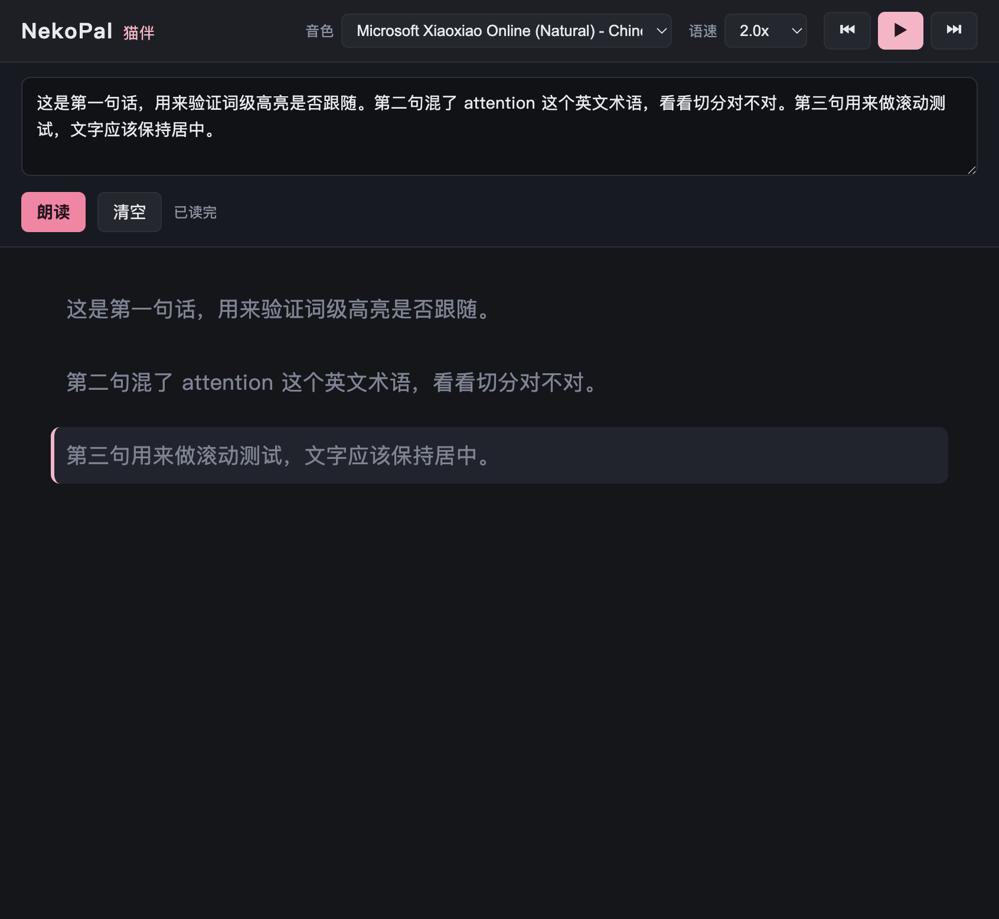

# NekoPal · 猫伴

> 让一个你喜欢的角色，把长文读给你听。
> 一整块内容丢给它 —— 它开始念，文字跟着声音逐句高亮、自动往下滚；它还能趴在桌面角落陪着你，把讲义变成通勤路上听的播客。

**NekoPal** 是一个本地运行的「**角色化朗读器**」。它把屏幕上任意位置的一整块文字，变成**能跟读的语音**，并且由**你自己选的角色**（Live2D 形象 + 克隆音色）来念。
它是「朗读工具」和「桌面陪伴」的交叉点：**不是聊天机器人，而是替你读书的伙伴。**



> 上图：朗读进行中。前两句已读完（变灰），当前句带活动边栏并自动居中；文字先渲染、声音随后跟上。

**当前状态**：MVP 已可用，且**opencode 回答完自动朗读已经打通**（`say` 离线 + Edge-TTS 联网，含词级高亮）。
下一步是把它从"浏览器标签页"变成"可双击打开的应用" —— 见 [`docs/进展与计划.md`](docs/进展与计划.md)。

---

## 为什么需要它

- **AI 让长文泛滥了**：一句话能说清的事，模型给你写 800 字。读完很累，但**闭上眼听**就还好。
- **讲义/文档想在路上听**：通勤、走路、做家务时，「听」是唯一能并行消费信息的方式。
- **现有方案各缺一块**：系统朗读没有跟读高亮、不能换音色；网页朗读插件进不了本机应用；TTS 阅读器（Speechify 等）没有角色、没有桌宠；VTuber 陪伴应用只会**聊天**，不会**朗读你的长文**。
- **中英混排是重灾区**：`attention`、`tokenizer`、`LoRA` 这类术语，很多中文语音会读坏。

NekoPal 的定位是：**整块朗读 + 跟读高亮 + 角色化身 + 离线优先**。

---

## 四个招牌玩法

| # | 玩法 | 一句话 |
| --- | --- | --- |
| 1 | **角色化朗读** | 你的 Live2D 角色读给你听，有口型、有表情 —— 而不是一个冰冷的机器音 |
| 2 | **自动续读（Follow）** | AI / 文件一有新内容就接着念，像电台播报；不用每次重新点 |
| 3 | **桌宠伴读** | 角色趴在屏幕角落，随时投喂内容就开读 |
| 4 | **通勤播客导出** | 一键把整份讲义 / 整条长回答导出 mp3，路上听 |

---

## 能力清单

| 特性 | 说明 | 状态 |
| --- | --- | --- |
| **整块抓取** | 一整个长回答 / 整篇文档 / 选定内容块，而不是一次一个词 | ✅ 可用 |
| **跟读高亮窗** | 独立阅读窗，逐词/逐句高亮 + 自动居中滚动 + 点任意句从那里读 | ✅ 可用 |
| **可插拔 TTS 后端** | `macOS say`（离线兜底）/ `Edge-TTS`（音色多）/ `GPT-SoVITS`（声音克隆） | ✅ say + edge（506 个音色） |
| **中英混排切分 + 读前清洗** | 跳过代码块与表格、`→` 读作"箭头"、术语按英文发音 | ✅ 可用 |
| **预合成队列 + 音频缓存** | 播第 N 句时合成第 N+1 句；相同内容只合成一次 | ✅ 可用 |
| **播放参数** | 语速实时切换（前端 `playbackRate`）；音量/音调（Edge-TTS） | ✅ 语速（0.75–2.0x） |
| **自动续读 Follow** | 监听内容源，只朗读新增部分 | 🔜 Phase 2 |
| **opencode 自动朗读** | 回答完自动推给跟读窗，无需复制粘贴 | ✅ **已打通** |
| **活动记录 `/api/activity`** | 记录推送来源与插件事件，出事一条命令定位 | ✅ 可用 |
| **进度书签** | 记住读到哪，下次接着读 | 🔜 Phase 2 |
| **原生窗口外壳** | `nekopal app`：不开浏览器、**无需点击**即可自动朗读 | ✅ 可用 |
| **导出音频** | `nekopal export`：wav / m4a **零额外依赖**（mp3 需 ffmpeg） | ✅ 可用 |
| **音色包 / 角色包（只做接口）** | `nekopal packs`：扫描、校验、模板；**不内置任何素材** | ✅ 可用 |
| **变声后端（RVC / DDSP-SVC）** | `nekopal convert`：`base_voice 合成 → 变声命令`，实测跑通要楽奈音色 | ✅ **可用**（常驻服务下 RTF 0.39） |
| **开机自启** | `nekopal autostart install`（macOS LaunchAgent） | ✅ 可用 |
| **导出 mp3（通勤播客）** | 一键把整篇导出为音频文件 | 🔜 Phase 2 |
| **文件模式** | 打开 `.md`，跟读窗自渲染整篇 | 🔜 Phase 2 |
| **可插拔音色包 / 角色包** | 音色与角色 = 素材 + 规范；仓库内**不含任何受版权保护的素材** | 🔜 音色包 Phase 3 |
| **Live2D 口型同步** | 用音频振幅或词级时间戳驱动口型 | 🔜 Phase 3 |
| **桌宠模式** | 透明背景 / 置顶 / 鼠标穿透 | 🔜 Phase 4 |
| **全局划词快捷键** | 辅助功能 API + 全局热键 | 🔜 可选 |

---

## 快速开始

```bash
cd NekoPal
uv venv --python 3.12
uv pip install -e ".[edge,dev,desktop]"   # desktop = 原生窗口外壳；不装也能用浏览器

uv run nekopal app                         # 🖥️ 打开原生窗口（推荐）
#   或  uv run nekopal serve               # 只跑服务，然后浏览器访问 http://127.0.0.1:8787/
```

**两种用法**：

| 方式 | 命令 | 特点 |
| --- | --- | --- |
| **原生窗口**（推荐） | `nekopal app` | 像一个真的应用；**自动朗读无需任何点击**；不用管浏览器标签页 |
| 浏览器 | `nekopal serve` + 打开 <http://127.0.0.1:8787/> | 零额外依赖；需点一次「启用自动朗读」 |

命令行也可以直接读：

```bash
uv run nekopal voices                      # 列出可用音色（含你自己导入的包）
uv run nekopal read "把这段文字读给我听"    # 直接在本机播放
uv run nekopal export --file 讲义.md       # 导出音频（通勤播客）
uv run nekopal packs list                  # 音色包 / 角色包（只做接口，不内置素材）
uv run nekopal convert test                # 变声链路自检（RVC / DDSP-SVC）
uv run nekopal autostart install           # 开机自启（macOS LaunchAgent）
```

**音色包 / 角色包（只做接口，不内置素材）**：

```bash
uv run nekopal packs dir                    # 我的包放哪（在仓库外，天然安全）
uv run nekopal packs init voice my-voice    # 生成音色包模板
uv run nekopal packs init character my-char # 生成角色包模板
uv run nekopal packs list                   # 扫到了什么、哪些被跳过了
```

> 📌 **本项目只提供加载接口，不打包任何音色 / Live2D 素材。** 素材放
> `~/.config/nekopal/voices/` 与 `~/.config/nekopal/characters/`（**在仓库外**），
> 或仓库内的 `voices/`、`characters/`（素材已被 `.gitignore` 排除）。
> 想用什么形象/音色由你决定，合规责任也在你自己 —— 详见
> [`docs/竞品与合规调研.md`](docs/竞品与合规调研.md) 第 10 节「虚拟形象来源与条款」。

**变声（RVC / DDSP-SVC 这类社区角色模型）**：它们多是「音频 → 音频」，不能直接喂文本，
所以走「先合成、再变声」的组合管线。完整步骤见
[`integrations/rvc/README.md`](integrations/rvc/README.md)：

```bash
# 一次性：装变声引擎（独立 venv）
export SDKROOT=/Library/Developer/CommandLineTools/SDKs/MacOSX26.sdk   # 本机 27.0 SDK 坏了
uv venv ~/.local/share/nekopal/rvc-venv --python 3.11
uv pip install --python ~/.local/share/nekopal/rvc-venv/bin/python \
    infer-rvc-python "setuptools<81" "transformers<5"

# 常驻变声服务（强烈推荐：单句 5.5s → 1.67s）
~/.local/share/nekopal/rvc-venv/bin/python integrations/rvc/serve.py --port 7899
```

**默认音色**：开箱只用**明确可用的来源**，无需任何额外素材——
默认是 **Edge-TTS「晓晓」**（联网、带词级时间戳），并配了**离线兜底**：断网或后端不可用时**逐句自动回退**到系统 `say`，不会没声音。
另可选 **VOICEVOX**（日语，商用可）。想用别的音色（包括自己录的声音）？把模型放进 `voices/` 即可，**项目不内置、不下载任何第三方模型**。

（想改默认音色：`NEKOPAL_DEFAULT_VOICE=edge:zh-CN-YunxiNeural uv run nekopal serve`）

**其他程序怎么推文本进来**（不需要任何系统权限）：

```bash
curl -X POST http://127.0.0.1:8787/api/read \
  -H 'Content-Type: application/json' \
  -d '{"text":"要朗读的一整块文字","voice":"say:auto"}'
# → {"task_id":"tsk_xxxxxxxx","segments":3,"sentences":3,"start_index":0}
# 再订阅 SSE 拿音频：GET /api/read/{task_id}/events
```

---

## 与其他工具集成

| 方式 | 适用场景 | 状态 |
| --- | --- | --- |
| 跟读窗粘贴 | 手动，最直接 | ✅ |
| `POST /api/read` | 任何程序推送整块文本 | ✅ |
| `scripts/push.py` | 命令行 / 编辑器插件 / 定时任务 | ✅ |
| **opencode 插件** | opencode 回答完**自动**朗读 | ✅ 已提供 |

### opencode：回答完自动朗读

```bash
uv run nekopal serve        # 先起服务
```

在 `~/.config/opencode/opencode.jsonc` 里加载插件，然后重启 opencode：

```jsonc
{
  "plugins": ["/Users/yuwenyan/Documents/NekoPal/integrations/opencode-plugin"]
}
```

它监听 `session.idle`（会话完成），取回最后一条足够长的助手消息推给跟随窗。
环境变量 `NEKOPAL_DEBUG=1` 可打印每个事件类型用于排查。
详见 [`integrations/opencode-plugin/README.md`](integrations/opencode-plugin/README.md)。

### 命令行推送

```bash
echo "一整块文字" | uv run python scripts/push.py
uv run python scripts/push.py --file 讲义.md --voice edge:zh-CN-XiaoxiaoNeural --follow
```

---

## 架构一图

```
┌──── 抓取层 capture ────┐   ┌────────── 后端 server ──────────┐   ┌── 跟读窗 web ──┐
│  整块抓取 (http_in)     │   │  清洗 → 分句 → 预合成队列        │   │  文本渲染       │
│  opencode 插件          │──►│  音频缓存 (内容寻址)             │──►│  高亮跟随       │
│  本地文件 (md/doc)      │HTTP│  TTS 后端注册表 (可插拔)         │SSE│  自动滚动       │
│  选区 (可选)            │   │  导出 / 进度书签                 │   │  播放控制       │
└────────────────────────┘   └─────────────────────────────────┘   └───────┬────────┘
                              say │ edge-tts │ gpt-sovits                    │ 状态同步
                                                                     ┌──────▼────────┐
                                                                     │ 角色层 avatar │
                                                                     │ Live2D / 口型 │
                                                                     └───────────────┘
```

各层**只通过一份接口契约通信**，因此每一层都可以单独替换或扩展（详见 [`docs/设计文档.md`](docs/设计文档.md) 第 6 章「扩展点」）。

---

## 目录导航

| 路径 | 内容 |
| --- | --- |
| [`docs/设计文档.md`](docs/设计文档.md) | **主文档**：目标、架构、接口契约、核心机制、扩展点、里程碑 |
| [`docs/开发规范.md`](docs/开发规范.md) | 目录结构、代码风格、Git 约定、测试约定 |
| [`docs/竞品与合规调研.md`](docs/竞品与合规调研.md) | 同类项目地图、可借鉴的工程实践、音色库现状与授权模式 |
| [`docs/进展与计划.md`](docs/进展与计划.md) | **做到哪了 / 接下来做什么**：进度总览、已完成清单、踩坑、改进计划 |
| [`voices/`](voices/README.md) | 音色包目录（只放规范与示例，**不含素材**） |
| [`characters/`](characters/README.md) | 角色包目录（Live2D 模型与音色的组合，**不含素材**） |
| `src/nekopal/` | 后端源码：`core/`（领域逻辑）、`tts/`、`capture/`、`avatar/`、`server/` |
| `web/` | 跟读窗前端，原生 HTML/CSS/JS，**无构建步骤** |
| `tests/` | 离线单元测试（29 个，`pytest`） |
| `scripts/smoke.py` | 端到端冒烟测试：POST → SSE → 取音频 |
| `scripts/push.py` | 把整块文字推给运行中的 NekoPal（管道 / 文件） |
| `integrations/opencode-plugin/` | opencode V2 插件：回答完自动朗读 |
| `docs/images/` | README 用的截图 |

---

## 路线图

| 阶段 | 目标 | 状态 |
| --- | --- | --- |
| **Phase 0** | 打通 Edge-TTS，拿到音频 + 词级时间戳；实测本机速度 | ✅ 完成（`say` RTF≈0.13，首段 0.53s） |
| **Phase 1 · MVP** | 整块抓取 + 后端（分句/队列/缓存/后端抽象）+ 跟读窗（高亮/滚动/语速） | ✅ 完成（`macos_ax` 划词除外） |
| **Phase 2 · 集成** | opencode 插件 + CLI 推送 | ✅ 已闭环 |
| **P1 · 外壳形态** | **pywebview 原生窗口**（自动朗读免点击） | ✅ **完成** |
| **Phase 2 · 剩余** | 导出 mp3 + Follow 续读 + 进度书签 + 文件模式 | ⏳ 待开始 |
| **Phase 3** | GPT-SoVITS 后端 + 音色包 + **角色层（Live2D + 口型同步）** | ⏳ 待开始 |
| **Phase 4** | **桌宠模式** + 打包 `.app` + 首启向导 + 跨平台抓取层 | ⏳ 待开始 |

> 详细的已完成清单、踩坑记录与分优先级计划见 [`docs/进展与计划.md`](docs/进展与计划.md)。

详细验收标准见 [`docs/设计文档.md`](docs/设计文档.md) 第 7 章。

---

## 设计原则

1. **离线优先，联网可选**：默认后端必须能离线工作，联网后端是"可选升级"。
2. **零依赖可用**：不装 PyTorch 也能跑；高质量音色与角色按需升级。
3. **接口先行**：抓取源、TTS 后端、清洗规则、角色层、播放参数全部通过抽象接口接入，主流程不写死。
4. **能力协商**：后端/角色声明自己支持什么（词级时间戳？变速？口型？），前端据此降级而不是硬编码假设。
5. **只做接口，不做分发**：项目提供的是**能力**，不是**内容**。第三方音色/角色模型一律由用户自备——不内置、不下载、不提供下载入口。
6. **默认即合法**：开箱可用的音色/角色全部来自**明确可用的来源**（系统音色、Edge-TTS 官方音色、VOICEVOX），无需任何额外素材即可完整使用。
7. **授权透明**：素材能否商用、能否再分发，在配置与界面中显式可见，判断权交给用户。
8. **朗读是核心，角色是加分**：即使不要角色、不要桌宠，它也必须是一个好用的朗读器。

---

## 许可证

待定（建议 MIT）。在正式发布前确认。

## 致谢

本项目的语音与角色能力建立在以下开源工作之上：

- [GPT-SoVITS](https://github.com/RVC-Boss/GPT-SoVITS) —— 少样本声音克隆
- [edge-tts](https://github.com/rany2/edge-tts) —— Edge 朗读接口的 Python 封装（非官方）
- [Open-LLM-VTuber](https://github.com/Open-LLM-VTuber/Open-LLM-VTuber) / [AIRI](https://github.com/moeru-ai/airi) —— Live2D 桌面伴侣的先行者
- [Live2D Cubism](https://www.live2d.com/) / [pixi-live2d-display](https://github.com/guansss/pixi-live2d-display) —— Live2D 渲染
- [Kokoro](https://github.com/hexgrad/kokoro) / [sherpa-onnx](https://github.com/k2-fsa/sherpa-onnx) —— 轻量离线 TTS 备选
